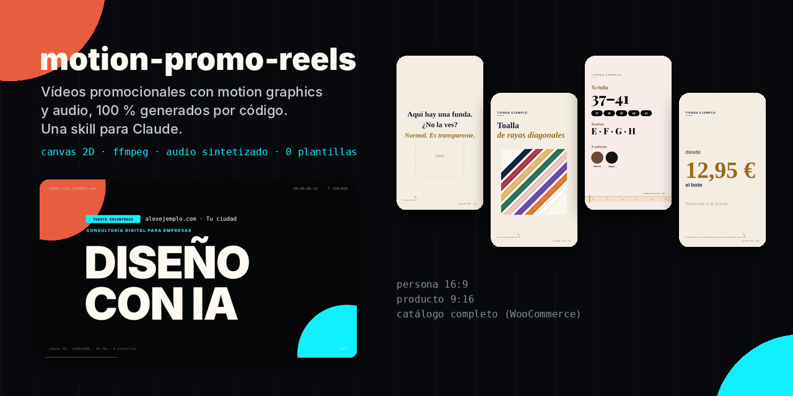
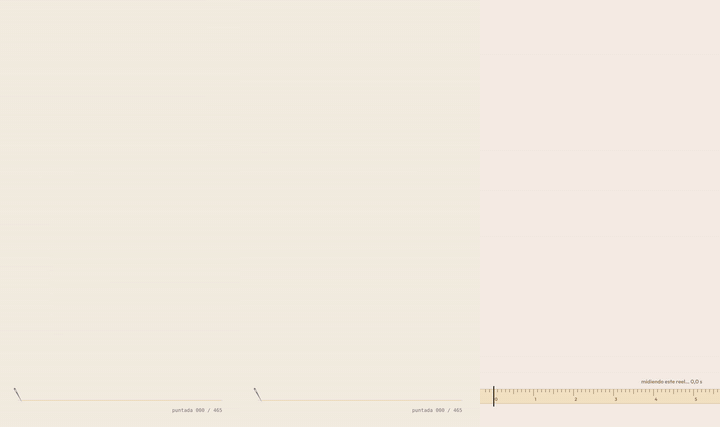

# motion-promo-reels

[English](README.md) · **Español**



Skill para Claude que genera **vídeos promocionales con motion graphics y audio, 100 % por código**: canvas 2D → fotogramas → ffmpeg, y música y efectos sintetizados con numpy. Sin plantillas de vídeo, sin After Effects y sin música de terceros.

Sirve para:
- una **persona o marca personal**: vídeo de 27 s en 16:9;
- **unos pocos productos**: reels de 15,5 s en 9:16, un gag escrito a mano por producto;
- **un catálogo entero** (WooCommerce): un reel por producto, gag por categoría, datos leídos de la tienda.

> Método probado en producción con proyectos reales: una marca personal, una tienda online pequeña y un catálogo de más de cien productos. Los datos de ejemplo de este repositorio son ficticios.

## Qué la hace distinta

<p align="center"></p>

- **Nada inventado.** Precios, colores, tallas y características salen de la web o de la API de la tienda, y lo que no se puede confirmar se marca como pendiente.
- **Un gag que es lo que hace el vídeo, no un chiste encima.** Un producto transparente → «Aquí hay una funda. ¿No la ves?». Uno con cuerpo en diagonal → el reel gira 45°. Uno de 50 metros → «Este reel dura 15 s. No te va a dar tiempo a gastarlo».
- **Elemento autorreferencial** durante todo el vídeo: HUD con fotogramas, costura con contador de puntadas o cinta métrica que «mide» el reel.
- **Control de calidad incluido:**
  - revisión de fotogramas;
  - zonas seguras de Instagram;
  - −14 LUFS;
  - etiqueta de IA (AI Act, art. 50) cuando las fotos llevan personas generadas con IA;
  - tono sereno para categorías sensibles.

## Estructura

```
motion-promo-reels/
├── SKILL.md                    instrucciones para Claude (el método completo)
├── assets/                     imágenes de este README
└── templates/
    ├── README.md               qué tocar primero en cada plantilla
    ├── persona-16x9/           marca personal (config CFG al inicio de anim.html)
    ├── producto-9x16/          pocos productos (productos.json)
    └── catalogo-9x16/          catálogo WooCommerce (config.json + extraer.js)
```

## Idiomas y textos

Claude te responde en tu idioma y escribe el texto del vídeo en el idioma de tu público. Los datos de ejemplo y los comentarios del código están en español. Todo el texto en pantalla se cambia sin tocar código:
- **Copy de marca y producto:** en `CFG` (persona), `productos.json` (producto) o `config.json` (catálogo).
- **Textos de interfaz** («desde», «colores», «NO ES ÉL», «midiendo este reel…»…): en un bloque `textos`. Vienen en español por defecto y solo cambias las claves que necesites. Ver [templates/README.es.md](templates/README.es.md#textos-de-interfaz).

## Instalación

**Claude Code**: clona el repositorio directamente como skill.

```bash
# macOS / Linux
git clone https://github.com/david-d2c2/motion-promo-reels ~/.claude/skills/motion-promo-reels

# Windows (PowerShell)
git clone https://github.com/david-d2c2/motion-promo-reels "$env:USERPROFILE\.claude\skills\motion-promo-reels"
```

También puedes clonarlo en `.claude/skills/` dentro de un proyecto concreto.

**claude.ai**: descarga [`motion-promo-reels.zip`](https://github.com/david-d2c2/motion-promo-reels/releases/latest/download/motion-promo-reels.zip) de la última *release*, súbelo en **Customize → Skills** (en la interfaz en español, el apartado de skills de Personalizar) y actívalo.

> Para esto no uses el botón verde *Code → Download ZIP* de GitHub: nombra la carpeta `motion-promo-reels-main`, y claude.ai exige que la carpeta se llame igual que la skill (`motion-promo-reels`). El zip de la *release* ya tiene la estructura correcta.

Después basta con pedirlo: *«hazme un reel promocional de este producto»*, *«investiga a [nombre] y crea un vídeo promocional con motion graphics»*, *«genera un reel por cada producto de mi tienda»*.

## Requisitos para renderizar

El render usa herramientas reales, así que donde mejor funciona es en Claude Code o Cowork en tu propio equipo. En un entorno en la nube, Claude instala lo que falte cuando puede.

- Node 18+ y `npm install` (instala `puppeteer-core`) en la plantilla que uses
- Chrome o Edge (o `CHROME_PATH`)
- ffmpeg en el PATH
- Python 3 con `numpy` y `scipy`

```bash
cd templates/producto-9x16
npm install
node render.js all --stills 1.6,3.4,7.4,10.4,12.4,14.4   # revisar
node render.js all                                       # vídeos en out/
```

## Licencias

- Código: [MIT](LICENSE).
- Fuentes incluidas (Inter, Gelasio, Playfair Display y Outfit): SIL Open Font License 1.1. Cada carpeta `fonts/` lleva su texto de licencia.
- Los vídeos que generes son tuyos. La música y los efectos se sintetizan en `audio.py`: no usan samples ni pistas de terceros.
