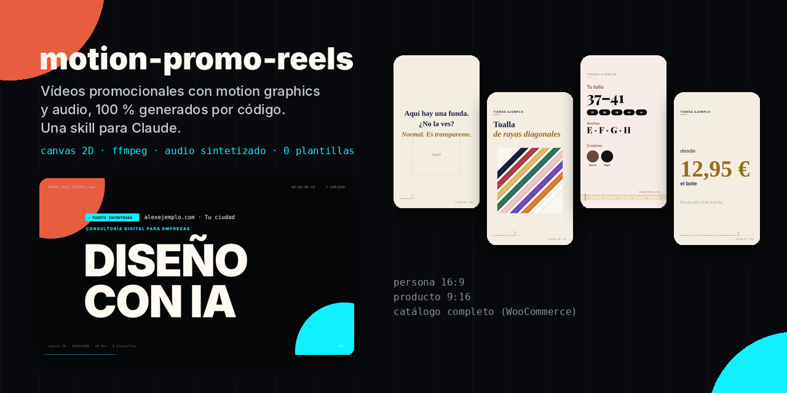
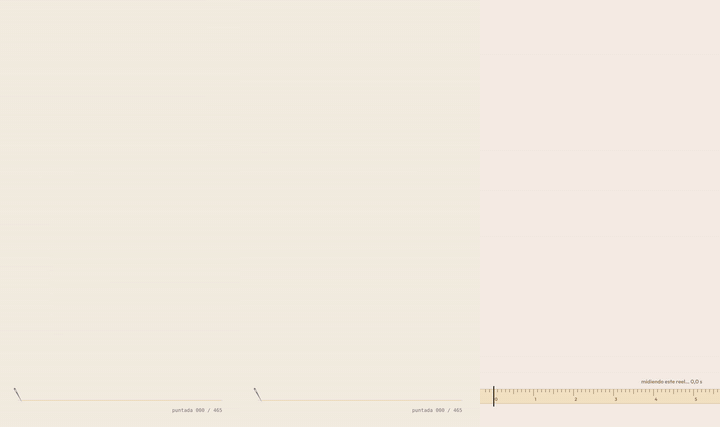
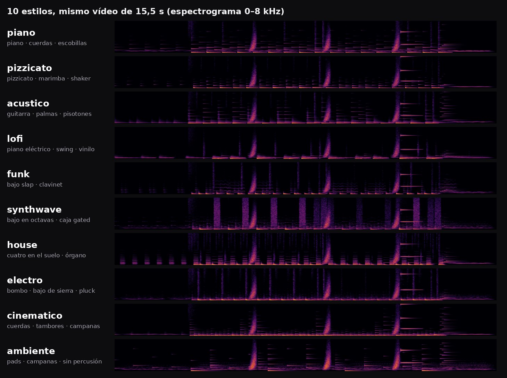
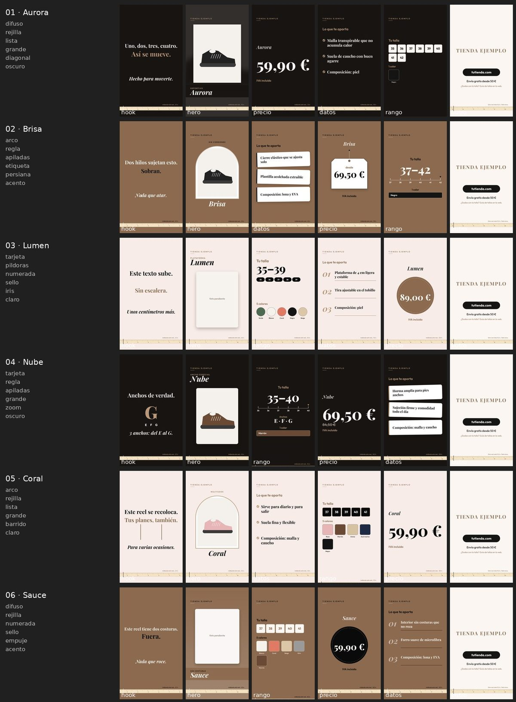
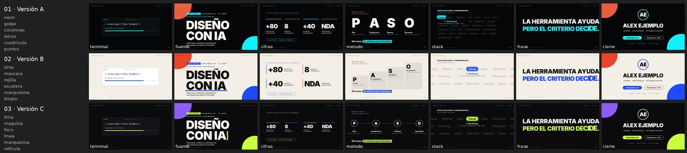

# motion-promo-reels

**English** · [Español](README.es.md)



A Claude skill that generates **promotional videos with motion graphics and audio, 100% by code**: 2D canvas → frames → ffmpeg, plus music and sound effects synthesized with numpy. No video templates, no After Effects, no third-party music.

It covers three cases:
- **a person or personal brand**: a 27 s video in 16:9, now with A/B/C versions on demand;
- **a handful of products**: 15.5 s reels in 9:16, one hand-written gag per product and, since v2, a different construction per reel;
- since v3, **music styles, sound-effect packs and an optional voice-over** in all three;
- **a whole catalog** (WooCommerce): one reel per product, a gag per category, data read straight from the store — and, since v2, **a different construction for every reel**.

> Battle-tested in production on real projects: a personal brand, a small online shop and a catalog of 100+ products. All sample data in this repository is fictional.

## What makes it different

<p align="center"></p>

- **Nothing made up.** Prices, colors, sizes and features come from the website or the store's API. Anything that can't be confirmed gets flagged as pending.
- **The gag is what the video does, not a joke on top.** A transparent product → *"There's a case here. Can't see it?"* A diagonal-striped one → the reel tilts 45°. A 50-metre roll → *"This reel lasts 15 s. You won't have time to use it up."*
- **A self-referential element** runs through the whole video: a HUD with frame counter, a stitch line counting stitches, or a tape measure that "measures" the reel.
- **Built-in quality control:**
  - frame-by-frame review;
  - Instagram safe zones;
  - −14 LUFS loudness;
  - an AI label (EU AI Act, art. 50) when photos show AI-generated people;
  - a calm tone for sensitive categories.

## v3: they don't sound alike either, and they can talk

v2 varied the picture; the music was still one loop with a different tempo or timbre. v3 replaces it:

- **Ten music styles** with their own instruments, drums, groove and harmony — not presets of the same loop. A **seed** composes each video's melody and picks its drum pattern, fills, harmonic rhythm and arpeggio, so two videos in the same style don't sound the same either.
- **The arrangement follows the scenes**: a sparse intro under the gag, the full band with the product, a lighter bed while facts are read, a drum fill before each cut and a final chord.
- **Five sound-effect packs** (`digital`, `organico`, `cinematico`, `minimo`, `juguete`), with chimes tuned to the music's key.
- **Optional voice-over** with ElevenLabs, [Voicebox](https://github.com/jamiepine/voicebox) (local and free) or any local TTS command. It only says what is on screen, caches every sentence (re-renders are free), stops at a character budget, ducks the music about 10 dB and writes an `.srt`.
- **Built to be run by any model:** `node comprobar.js` checks the environment and the data and says where each problem is and how to fix it; `SKILL.md` opens with a step-by-step quick path; `install.sh --agents` installs into `~/.agents/skills` for agents such as pi.

<p align="center"></p>

Nothing new is mandatory: no new dependencies, and without `locucion.json` there is no voice.

## v2: fifty reels that don't look like one

In v1 every reel of a template shared the same timeline, layout, transition, colors, music and — within a catalog category — the same hook text. Fifty products gave you fifty copies of one film with different numbers.

v2 gives every video a **plan**, chosen by a seeded planner that compares it with the videos published right before it. All three templates share one variation core (`variacion.js`), so they behave the same way. For catalogs:

| Axis | Options |
|---|---|
| Scene order | 6 orders of range, facts and price after the product reveal |
| Product scene | card · blurred backdrop + full photo · arch frame |
| Range scene | pills · ruler + color stripes · tile grid |
| Facts scene | checklist · numbered 01–03 · stacked cards |
| Price scene | big · round stamp · hanging tag |
| Transition | flash · push · iris · diagonal · blinds · zoom (crossfade for sensitive categories) |
| Color theme | light · dark · accent — derived from the brand palette, only when WCAG contrast passes |
| Hook | text entrance (rise · mask · letters) and **phrase variants that rotate within each category** |
| Music | progression · key · tempo · timbre · arpeggio pattern (audio reads the same plan, so sound and picture stay in sync) |

The brand signature stays fixed on purpose: the self-referential tape measure and the closing card.

<p align="center"></p>

**A few products** get the same axes with layouts of their own (a Polaroid that drops in, a color fan deck, facts on sewn labels, a hanging price tag), while keeping each product's hand-written gag.

**A personal video** is a story, so its order never changes (the namesake gag depends on it). Instead you get **versions** — for different channels or to post again — that change the palette, the headline entrance, the stats, method and stack layouts, the background and the music:

<p align="center"></p>

```bash
# catalog and products
node variar.js                       # plan new products, keep existing plans → VARIACION.md (batch report)
node variar.js --temporada 2027-01   # a fresh look for every reel, to publish again
node render.js all --hoja            # contact sheets: one row per reel, one frame per scene

# person
node variar.js 3                     # versions A, B and C, as different as possible → versiones.json
node render.js video promo_B.mp4 --version B
node render.js hoja                  # contact sheet of all versions
```

Plans are reproducible and hand-editable (`"manual": true` protects a product's plan). Without a plan, every template renders exactly like v1, minus the v1 bugs fixed along the way. See [CHANGELOG.md](CHANGELOG.md).

## Structure

```
motion-promo-reels/
├── SKILL.md                    instructions for Claude (the full method)
├── install.sh / install.ps1    one-line installers (curl / PowerShell)
├── assets/                     images for this README
└── templates/
    ├── README.md               what to change first in each template
    ├── persona-16x9/           personal brand (CFG block at the top of anim.html + versiones.json)
    ├── producto-9x16/          a few products (productos.json + variar.js)
    └── catalogo-9x16/          WooCommerce catalog (config.json + extraer.js + variar.js)
```

The skill is language-agnostic: Claude replies in your language and writes the on-screen copy in your audience's language. The sample data and code comments are in Spanish. All on-screen text can be changed without touching code:
- **Product and brand copy** lives in `CFG` (persona), `productos.json` (product) or `config.json` (catalog).
- **Interface strings** ("from", "colors", "NOT HIM", "measuring this reel…"…) live in a `textos` block. Spanish defaults are built in; override only the keys you need. See [templates/README.md](templates/README.md#interface-strings).

## Installation

**Claude Code**: pick whichever method you prefer. All of them leave the skill in `~/.claude/skills/motion-promo-reels` unless you choose another folder.

```bash
# npx (Node 18+), using the open skills CLI
npx skills add david-d2c2/motion-promo-reels -g -a claude-code   # all your projects
npx skills add david-d2c2/motion-promo-reels -a claude-code      # current project only

# curl (macOS / Linux)
curl -fsSL https://raw.githubusercontent.com/david-d2c2/motion-promo-reels/main/install.sh | bash
curl -fsSL https://raw.githubusercontent.com/david-d2c2/motion-promo-reels/main/install.sh | bash -s -- --dir /path/to/skills
curl -fsSL https://raw.githubusercontent.com/david-d2c2/motion-promo-reels/main/install.sh | bash -s -- --project
```

```powershell
# Windows (PowerShell)
irm https://raw.githubusercontent.com/david-d2c2/motion-promo-reels/main/install.ps1 | iex
& ([scriptblock]::Create((irm https://raw.githubusercontent.com/david-d2c2/motion-promo-reels/main/install.ps1))) -Dir "D:\skills"
```

The `install.sh` / `install.ps1` options:

| Option | Effect |
|---|---|
| `--dir PATH` / `-Dir PATH` | Installs into `PATH/motion-promo-reels` |
| `--project` / `-Project` | Installs into `./.claude/skills/` of the current folder |
| `--agents` / `-Agents` | Installs into `~/.agents/skills/`, for agents that read that folder (such as pi) |
| `--force` / `-Force` | Replaces an existing installation (updating) |
| `--version TAG` / `-Version TAG` | Installs a specific release instead of the latest |

Both scripts download the same zip as the release below. Read them before piping them into a shell: they are short.

Or with git:

```bash
git clone https://github.com/david-d2c2/motion-promo-reels ~/.claude/skills/motion-promo-reels
```

**claude.ai**: download [`motion-promo-reels.zip`](https://github.com/david-d2c2/motion-promo-reels/releases/latest/download/motion-promo-reels.zip) from the latest release and upload it under **Customize → Skills**, then turn it on.

> Don't use GitHub's green *Code → Download ZIP* button for this: it names the folder `motion-promo-reels-main`, and claude.ai requires the folder to match the skill name (`motion-promo-reels`). The release zip is built with the right layout.

Then just ask: *"make a promo reel for this product"*, *"research [name] and create a promotional video with motion graphics"*, *"generate one reel for every product in my store"*.

## Rendering requirements

Rendering runs real tools, so it works best where they're installed: Claude Code, Cowork or any coding agent on your own machine. In a cloud sandbox, the agent installs what's missing when it can.

- Node 18+ and `npm install` (installs `puppeteer-core`) inside the template you use
- Chrome or Edge (or `CHROME_PATH`)
- ffmpeg on your PATH
- Python 3 with `numpy` and `scipy` (plus `Pillow` for the batch contact sheets)

```bash
cd templates/producto-9x16
npm install
node comprobar.js                                        # environment + data check, with fix-it messages
node render.js all --stills 1.6,3.4,7.4,10.4,12.4,14.4   # review frames
node render.js all                                       # final videos in out/
```

## Licenses

- Code: [MIT](LICENSE).
- Bundled fonts (Inter, Gelasio, Playfair Display, Outfit): SIL Open Font License 1.1. Each `fonts/` folder includes its license text.
- The videos you generate are yours. Music and sound effects are synthesized in `sonido.py`: no samples or third-party tracks. A voice-over is subject to the terms of the provider you choose (ElevenLabs, Voicebox's engines…), and a cloned voice needs its owner's consent.
